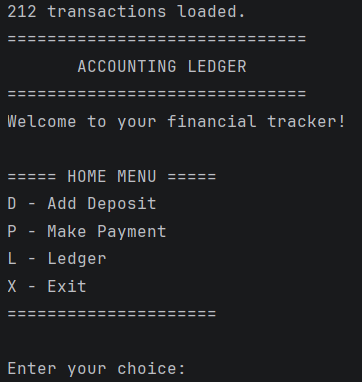
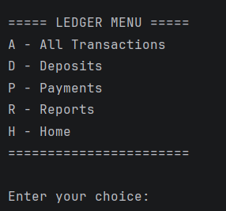
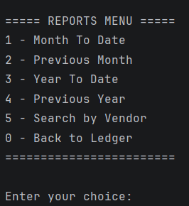
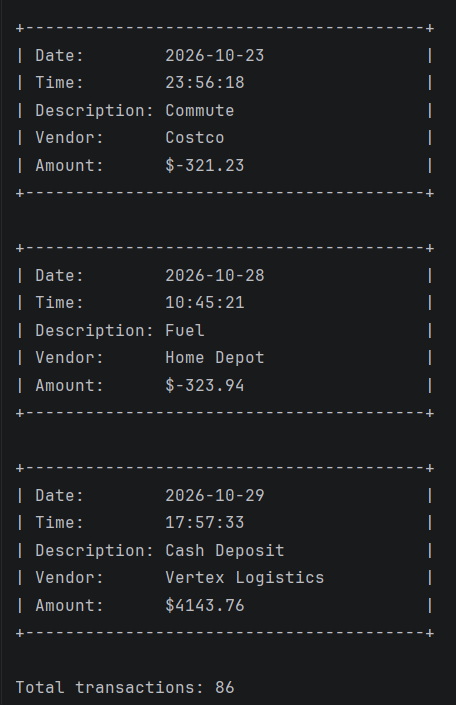

# Accounting Ledger 
## Project Description: 
The Accounting Ledger is a Java-based application designed to help users manage and track their financial transactions. Users can record deposits and payments, view their transaction history, and generate financial reports based on specific dates or vendors.
The program also has reporting tools that make tracking financial activity simple and efficient.
### Features:
- Transaction Management – Add deposits and payments while tracking financial activity.
- Transaction History – View all transactions, deposits, or payments separately.
- Financial Reports – Generate Month-to-Date, Previous Month, Year-to-Date, and Previous Year reports.
- Vendor Search – Search transactions by vendor name.
- CSV File Storage – Save transactions to a CSV file and automatically load existing records when the application starts.
- Input Validation – Prevent invalid entries, including blank descriptions and incorrect transaction amounts.
- Menu-Driven Navigation – Navigate between Home, Ledger, and Reports using an interactive console menu.
- Formatted Transaction Cards – Display transaction details in a clean, organized layout.
- Transaction Counters – Show the total number of transactions displayed in each ledger view or report.
- Automatic Date and Time Tracking – Record the current date and time when adding new transactions.
### Technologies Used:
- Java
- IntelliJ IDEA
- Git and GitHub
- CSV File Handling
- Object-Oriented Programming
- ArrayList
- LocalDate and LocalTime
### Project Structure: 
```text
accounting-ledger/
│
├── src/
│   ├── App.java
│   └── Transaction.java
│
├──  README.md 
└── transactions.csv
```
### How to Run 
1. Clone or download the repository from GitHub.
2. Open the project in IntelliJ IDEA.
3. Make sure transactions.csv is located in the project root.
4. Open App.java.
5. Run the main() method.
6. Follow the menu options to manage transactions and generate reports.
## Interesting Code:
One of the most interesting parts of this project is how the application reads transactions from a CSV file and converts them into Java objects.
```java
String[] parts = line.split("\\|", -1);

LocalDate date = LocalDate.parse(parts[0]);
LocalTime time = LocalTime.parse(parts[1]);

String description = parts[2];
String vendor = parts[3];
double amount = Double.parseDouble(parts[4]);

Transaction transaction = new Transaction(
date, time, description, vendor, amount);

transactions.add(transaction);
```
This code separates each CSV row into individual values, converts the date, time, and amount into their correct Java data types, and creates a Transaction object.

The object is then added to an ArrayList, allowing the application to display and filter transactions without repeatedly reading the CSV file.

This snippet runs after the application validates the CSV row.
## What I learned
### Through this project, I gained experience with:
Organizing Java programs using methods and classes

- Working with ArrayLists and objects
- Reading and writing CSV files
- Using loops and conditional statements
- Validating user input
- Filtering data by date and vendor
- Debugging and testing a console application
- Managing project changes with Git and GitHub
## Future Improvements 
### Possible future improvements include: 
- adding transaction sorting 
- displaying account balances 
- allowing users to edit or delete transactions

## Screenshots 
### Home Menu:

### Ledger Menu:

### Reports Menu:

### Transaction Results:


